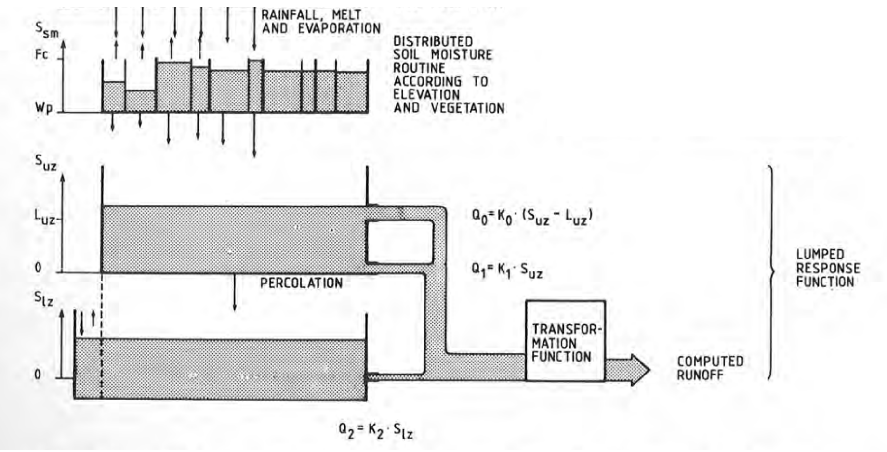
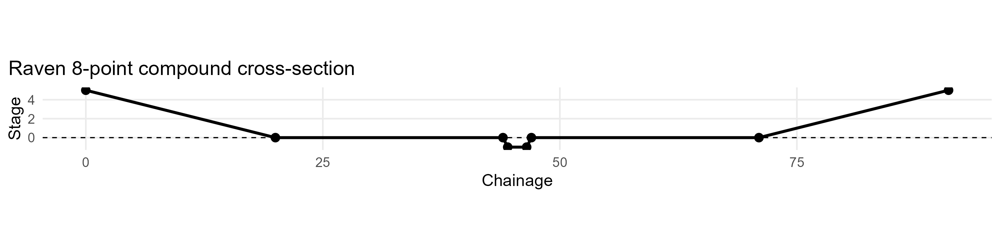
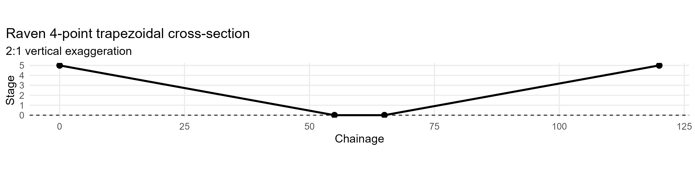

[](https://raven.uwaterloo.ca/)

A regional semi-distributed rainfall-runoff model has been developed to simulate regional-scale hydrologic processes at the sub-watershed scale. The model is developed using Raven: a state-of-the-art [hydrological framework](https://raven.uwaterloo.ca/) written by Dr. James Craig at the University of Waterloo. In particular, the HBV formulation is applied as its results can be mapped to the 60x60 grid used with the integrated [Water Budget model](/interpolants/modelling/waterbudgetmodel.html).

The model was initially built to support the Water Budget (recharge) model in that it is built on a similar [sub-basin network](/interpolants/interpolation/subwatershed.html), [land-use](/interpolants/interpolation/landuse.html), [surficial geology](/interpolants/interpolation/surfgeo.html) and [climate forcings](/interpolants/sources/climate-data-service.html).


# Model Design

The model is built off the same 4,230 sub-watersheds used in the climate data service and the integrated water budget model. Raven (HBV) uses the semi-distributed *Hydrological Response Unit* (HRU) formulation which groups the land surface into common climate, land use, and surficial geology categories. After grouping unique permutations, the 12.4M grid cells analyzed in the water budget model are reduced to 18,515 distinct HRUs. The model then computes the hydrology of these HRUs and the results are then mapped back to the original grid. This reduction to HRUs greatly improves model run times.

The latest model build can be found [here](https://github.com/OWRC/OWRC-Raven).

## The HBV model


> Modified fig.2 in Bergström (1992).


### Raven Primary Input file (.rvi)
```
:StartDate 2002-10-01 00:00:00
:EndDate   2025-10-01 00:00:00
:TimeStep  1.0

:InterpolationMethod  INTERP_NEAREST_NEIGHBOR
:RainSnowFraction     RAINSNOW_THRESHOLD
:Evaporation          PET_OUDIN
:OW_Evaporation       PET_OUDIN
:PrecipIceptFract     PRECIP_ICEPT_LAI
:CatchmentRoute       ROUTE_TRI_CONVOLUTION
:Routing              ROUTE_DIFFUSIVE_WAVE

:SoilModel            SOIL_MULTILAYER 3
:Alias                TOPSOIL        SOIL[0]
:Alias                FAST_RESERVOIR SOIL[1]
:Alias                SLOW_RESERVOIR SOIL[2]
:LakeStorage          SLOW_RESERVOIR

:HydrologicProcesses        ALGORITHM            Process from     Process to
  :Precipitation            RAVEN_DEFAULT        ATMOS_PRECIP     MULTIPLE
  :CanopyEvaporation        CANEVP_ALL           CANOPY           ATMOSPHERE
  :Infiltration             INF_HBV              PONDED_WATER     MULTIPLE
  :Flush                    RAVEN_DEFAULT        SURFACE_WATER    FAST_RESERVOIR
     :-->Conditional HRU_TYPE IS_NOT LAKE
  :SoilEvaporation          SOILEVAP_HBV         TOPSOIL          ATMOSPHERE
  :CapillaryRise            CRISE_HBV            FAST_RESERVOIR   TOPSOIL

  :Percolation              PERC_CONSTANT        FAST_RESERVOIR   SLOW_RESERVOIR
     :-->Conditional LAND_CLASS IS_NOT Urban
  :Percolation              PERC_LINEAR          FAST_RESERVOIR   SLOW_RESERVOIR
     :-->Conditional LAND_CLASS IS Urban

  :Baseflow                 BASE_LINEAR          FAST_RESERVOIR   SURFACE_WATER
     :-->Conditional LAND_CLASS IS_NOT Urban
  :Baseflow                 BASE_THRESH_STOR     FAST_RESERVOIR   SURFACE_WATER
     :-->Conditional LAND_CLASS IS_NOT Urban
  :Baseflow                 BASE_POWER_LAW       FAST_RESERVOIR   SURFACE_WATER
     :-->Conditional LAND_CLASS IS Urban

  :Baseflow                 BASE_LINEAR          SLOW_RESERVOIR   SURFACE_WATER
:EndHydrologicProcesses
```

## Precipitation and Evapotranspiration


### Climate input data
Historical precipitation $(P)$ and minimum and maximum air temperature $(T_a)$ are derived primarily from Environment and Climate Change Canada (ECCC) climate-station observations, supplemented in the modern period by ECCC's Regional Deterministic Precipitation Analysis (RDPA/HRDPA), which combines gauge, radar, and numerical weather prediction information. Snow accumulation and melt are represented using SNODAS for the period in which it is available, with historical snowmelt estimated using the ORMGP processing workflow. These datasets are processed through a Delft-FEWS system and spatially interpolated to model HRUs. For this application, the ORMGP-CDS provides rainfall plus snowmelt **(i.e., atmopheric yeild)** directly as a model forcing, thereby avoiding the need to explicitly simulate snow accumulation and melt within Raven and ensuring consistency with the broader regional climate-data framework.

### Potential Evaporation $(E_p)$

`PET_OUDIN` follows Oudin et al. (2005), in millimetres per day  [mm/day], where:

$$
   E_p = \frac{R_e}{\lambda\rho}\frac{T_a+5}{100}\cdot\texttt{PET_CORRECTION}
$$

and $R_e$ is the extraterrestrial radiation $(\text{MJ}\cdot \text{m}^{-2} \text{day}^{-1})$ and $T_a$ is mean daily air temperature $(\degree \text{C})$. Constants properties $\lambda$ and $\rho$ are the latent heat flux $(\text{MJ}\cdot \text{kg}^{-1})$ and the density of water $(\text{kg}\cdot \text{m}^3)$, respectively. 

Extraterrestrial irradiation $(R_e)$ on a sloped surface is computed following FAO-56 (Allen et al., 1998; Duffie and Beckman, 2013). Solar incidence on sloped terrain was numerically integrated over daylight hour angles. This calculation returns the amount of solar flux $(\text{MJ}\cdot \text{m}^{-2})$ received on a sloping surface--used as a proxy to length of daylight.

`PET_CORRECTION` is also added as a tuning parameter.


### Vegetation

Canopy interception of precipitation was simulated using Raven's LAI-based interception algorithm (`PRECIP_ICEPT_LAI`) and was applied only to HRUs with mapped vegetative canopy cover. Precipitation falling on HRUs without mapped canopy was not subject to interception. For vegetated HRUs, Interception is limited by the available canopy storage capacity, which varies seasonally in proportion to leaf area index (LAI). The fraction of precipitation intercepted by the canopy is calculated as a linear function of LAI, following Dingman (2002), with separate vegetation-specific interception factors for precipitation. 

The the potential rate of interception [mm/day] is related to the monthly $\text{LAI}$ value:

$$ R_\text{int}=\min\left(\texttt{RAIN_ICEPT_FACT}\cdot\text{LAI},1.0 \right)\cdot P $$

Interception loss [mm/day] is limited by the `MAX_CAPACITY` parameter defined by:

$$
   E_\text{int} = 
   \begin{cases}
      R_\text{int} \qquad & \text{if } R_\text{int}\leq C_\text{int}\\
      C_\text{int} & \text{otherwise}
   \end{cases}
$$

and

$$ C_\text{int} = \texttt{MAX_CAPACITY} \cdot \frac{\text{LAI}}{\text{LAI}_\text{max}} $$

Interception storage is flushed daily (`CANEVP_ALL`--assumed evaporated) and throughfall is thus $R=P- \left(\texttt{FOREST_COVERAGE}\cdot E_\text{int} \right)$,  [mm/day].


### Soil layers

HBV represents subsurface water storage using three conceptual soil layers:

1. **Topsoil** represents water retained in the shallow soil and macropore system. Water stored in this layer can be lost directly through evaporation.
1. **Fast Reservoir** represents relatively rapid subsurface storage that becomes particularly active during larger precipitation or snowmelt events. Water from this reservoir contributes to rapid runoff generation.
1. **Slow Reservoir** represents the local shallow groundwater system and provides the longer-term baseflow contribution to the river network.

Evaporation occurs directly only from the **Topsoil** layer. However, water stored in the Fast Reservoir (\(S_\text{fast}\)) can also contribute indirectly to evaporative losses through capillary rise into the Topsoil layer.

All Topsoil layers share the same global model parameters. Only the effective soil depth is differentiated among urban, agricultural, and natural land-cover classes.


### Soil Evaporation

Soil Evaporation (`SOILEVAP_HBV`) from the **Topsoil** layer follows Bergström (1992):

$$ E_\text{soil}=E_p\cdot\min\left(\frac{S_\text{sm}}{\text{FC}\cdot\text{LP}},1\right), $$

where $S_\text{sm}$ is the water stored in the Topsoil layer, $\text{FC}$ is the maximum topsoil moisture storage and $\text{LP}$ is the threshold with which evaporation rates delcline linearly with available stored water. 

In Raven the HBV parameter:
- $\text{FC}$ is specified by the Topsoil layer depth when `POROSITY` is to $1$.
- $\text{LP}$ is specified by `FIELD_CAPACITY` when `SAT_WILT` is to $0$.


### Infiltration

Infiltration (`INF_HBV`) into the **Topsoil** layer follows Bergström (1992):

$$ f = R\cdot(1-\texttt{IMPERMEABLE_FRAC})\cdot\left[1-\left(\frac{S_\text{sm}}{\text{FC}}\right)^\beta\right] $$

and thus surface runoff $q=R-f$ is routed to the Fast Reservoir. $\beta$ is a tuning parameter (`HBV_BETA`). 

<!-- Note, by setting `POROSITY`$=1$. -->


### Capillary Rise

Lastly, `CRISE_HBV` is used to route water from the fast reservoir back to the topsoil layer using:

$$ M_\text{cr} = \texttt{MAX_CAP_RISE_RATE}\cdot \left(1-\frac{S_\text{sm}}{\text{FC}}\right). $$


## Groundwater Recharge and Runoff

Runoff generation is conceptualized separately for two broad land-use classes: **urbanized areas** and **non-urban areas**, reflecting differences in drainage pathways, recharge and runoff generation.

### Urbanized Areas

Within urbanized areas, **recharge** is used to represent losses from leaky stormwater infrastructure. Water entering the storm drainage system may be lost through cracks, joints, or other leakage pathways and subsequently infiltrate into the underlying soil and groundwater system. This process is therefore treated as a recharge flux rather than direct surface infiltration using `PERC_LINEAR`:

<!-- $$ g = \frac{1}{20}S_\text{fast} $$ -->

$$ g = \texttt{PERC_COEFF}\cdot S_\text{fast} $$

- $g$ is recharge to the groundwater system [mm/day]
- $S_\text{fast}$ is the fast storage reservoir
- `PERC_COEFF` is the linear percolation coefficient [1/day]

Recharge removes water from the fast reservoir according to:

$$
S_\text{fast}^{+}=S_\text{fast}-g
$$

This formulation causes leakage to increase with the volume of water stored within the urban drainage system and to decline as the system drains.

**Runoff** from urbanized areas is represented using a nonlinear power-law relationship (`BASE_POWER_LAW`):

$$ q_\text{fast} = kS^n_\text{fast} $$

- $q_\text{fast}$ is runoff from the fast reservoir [mm/day]
- $k$ is the runoff coefficient `BASEFLOW_COEFF`
- $n$ is a scaling parameter `BASEFLOW_N`


### Non-urbanized areas

Within non-urbanized areas, **recharge** is assumed constant and proportional to the saturated hydraulic conductivity of the soil under an assumed unit hydraulic gradient:

$$ g = \texttt{MAX_PERC_RATE_MULT}\cdot \texttt{MAX_PERC_RATE} $$

- $g$ is recharge to the groundwater system [mm/day]
- `MAX_PERC_RATE_MULT` is the global scaling factor, and
- `MAX_PERC_RATE` is the estimated saturated hydraulic conductivity of the soil $(k_\text{sat})$ .

**Runoff** from non-urbanized areas follows the traditional HBV-style threshold formulation (using `BASE_LINEAR` and `BASE_THRESH_STOR`), in which drainage from the fast reservoir increases once storage exceeds a specified threshold:

<!-- $$
  q_\text{fast} = \begin{cases}
        kS_\text{fast} &\qquad \text{when $S_\text{fast}$ < $S_\text{thresh}$} \\
        k\left(2S_\text{fast}-S_\text{thresh}\right)
  \end{cases}
$$ -->

$$
  q_\text{fast} = \begin{cases}
        kS_\text{fast} &\qquad \text{when $S_\text{fast}$ < $S_\text{thresh}$} \\
        kS_\text{fast} + k'(S_\text{fast}-S_\text{thresh}) &\qquad \text{otherwise}
  \end{cases}
$$

- $q_\text{fast}$ is runoff from the fast reservoir [mm/day]
- $k$ ans $k'$ are the runoff coefficients `BASEFLOW_COEFF` and `BASEFLOW_COEFF2`, respectively
- $S_\text{thresh}$ is the threshold storage `STORAGE_THRESHOLD`

Below the threshold, runoff increases linearly with fast-reservoir storage. Once the threshold is exceeded, the effective drainage rate increases, representing the activation of a more rapid runoff pathway under wetter conditions.


### Baseflow

Baseflow from the slow reservoir is represented using a linear storage–discharge relationship (`BASE_LINEAR`):

$$ q_\text{slow} = kS_\text{slow} $$

- $q_\text{slow}$ is discharge from the slow reservoir [mm/day]
- $k$ is the baseflow coefficient `BASEFLOW_COEFF`
- $S_\text{slow}$ is the slow storage reservoir [mm]

Baseflow discharge depletes the slow reservoir according to:

$$ S^+_\text{slow}=S_\text{slow}-q_\text{slow} $$

This formulation represents groundwater discharge as a linear reservoir, such that baseflow increases proportionally with groundwater storage and gradually declines as the reservoir is depleted.


## Routing

Runoff was routed through the watershed using separate in-catchment and in-channel routing schemes in Raven. Within each subbasin, runoff generated by the HRUs was routed to the subbasin outlet using a triangular unit hydrograph (`ROUTE_TRI_CONVOLUTION`), with the timing and dispersion of runoff controlled by the subbasin time-to-peak and time-of-concentration parameters. Flow was subsequently routed downstream through the connected river network using the diffusive-wave routing algorithm (`ROUTE_DIFFUSIVE_WAVE`). This method controls the attenuation and spreading of the flood wave as it propagates downstream.


### Channel cross-sections

Channel geometry and channel roughness are primarily specified by Strahler stream order. Higher-order streams are assigned progressively larger channel widths and depths, reflecting their greater contributing area and discharge capacity. Channel roughness (Manning's $n$) is also grouped by stream order, allowing smaller headwater channels to have higher roughness and larger downstream channels to have lower roughness. This avoids calibrating each reach independently and instead applies a consistent hydraulic relationship across the full model network.

Floodplain roughness is specified by physiographic region, since overbank flow is more strongly influenced by regional differences in valley form, surficial geology, vegetation, wetlands, and floodplain character. Each reach therefore receives channel properties from its stream-order class and floodplain roughness from its physiographic class.

Channels are defined using two idealized cross-sectional forms. Both are symmetric, but they interpret the channel and valley differently.


#### Form 1: 8-point compound cross-section

This form explicitly represents:

- the outer valley sides,
- a flat floodplain on each side of the channel,
- sloping channel banks, and
- an incised, flat channel bottom.



#### Form 2: trapezoidal cross-section

The second form consists of two sloping sides and a single flat central bottom and is reserved for lake outlets. It does not separately represent floodplain benches and an incised channel.



---

## Additional build notes

- Sub-watersheds where >80% of their area is covered by waterbodies and wetlands and where waterbodies are the dominant feature (i.e., greater coverage than wetlands) are deemed lake sub-watersheds.
- HRUs defined in each sub-watershed (as a unique combination of land use and surficial geology combinations) that do not cover 5% of the sub-watershed area are excluded from the model and are assumed to take the average results from the remaining sub-watershed.
- Model is run in daily time steps from October 1993 through September 2023.

> WARNING: The model currently remains largely un-calibrated.

## Comparison to an Integrated Water Budget

While a standard in the hydrological community, models such as Raven are designed to neglect the role of groundwater influence on runoff generation. In most cases this can be a fair simplification, especially during the onsets of extreme rainfall events, which is likely the most prominent use case of such models. The problem is that in many areas (of southern Ontario), [water tables are close to (or even above) ground surface](/watertable/). What this means is that recharge cannot occur in these areas yet standard hydrological models fail to account for this. In practice, areas where seepage is known to occur, such as wetlands (fens), modellers are forced to "effectively" treat wetlands as an impervious surface. Computationally, wetlands are thus no different than a parking lot.

By design, integrated models treat the water table explicitly and so no effective treatment of the exchange of water between the subsurface and ground surface is required. Modeller discretion is eliminated and a physical treatment of the hydrological system is maintained. Below is an illustration of a Raven output with that of the ORMGP [integrated water budget model](/interpolants/modelling/waterbudgetmodel.html). Notice how features such as streams become an emergent property of the landscape gaining groundwater discharge as baseflow, not a feature built into the model.

<iframe src="https://golang.oakridgeswater.ca/pages/Raven23WB-compare.html" width="100%" height="400" scrolling="no" allowfullscreen></iframe>

_Comparison of groundwater recharge simulated using Raven vs. an integrated groundwater/surface water model (mm/yr). Notice how in the integrated case much of the low lying areas exhibit negative "net recharge", meaning that these are area where water tables are high and seepage to the surface is being simulated._

# Contact

Should more information on the model wish to be known or if a subset of the model wish to be used, please contact support@owrc.ca.


# Other resources:

- [**RavenView**](https://raven.uwaterloo.ca/RavenView/RavenView.html) is an online tool Raven users can use to view model results.
- [**RavenR**](https://raven.uwaterloo.ca/RavenR.html) is an [**R**](https://www.r-project.org/) package that can be used to build Raven models and report results.


# References

Allen, R. G., Pereira, L. S., Raes, D., & Smith, M. (1998). Crop evapotranspiration: Guidelines for computing crop water requirements. FAO Irrigation and Drainage Paper No. 56. Food and Agriculture Organization of the United Nations, Rome.

Bergström, S. (1992). [The HBV model: Its structure and applications](https://www.smhi.se/download/18.38e7941719209b36a1fb2c4/1728367395288/RH_4.pdf?utm_source=chatgpt.com). SMHI Reports Hydrology, No. 4. Swedish Meteorological and Hydrological Institute.

Dingman, S. L. (2002). Physical Hydrology (2nd ed.). Prentice Hall, Upper Saddle River, New Jersey.

Duffie, J. A., & Beckman, W. A. (2013). Solar engineering of thermal processes (4th ed.). John Wiley & Sons. https://doi.org/10.1002/9781118671603

Oudin, L., Hervieu, F., Michel, C., Perrin, C., Andréassian, V., Anctil, F., & Loumagne, C. (2005). Which potential evapotranspiration input for a lumped rainfall–runoff model? Part 2—Towards a simple and efficient potential evapotranspiration model for rainfall–runoff modelling. Journal of Hydrology, 303(1–4), 290–306. https://doi.org/10.1016/j.jhydrol.2004.08.026

